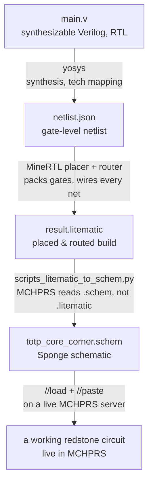

# The M in MFA stands for Minecraft

 

A working TOTP (Time-based One-Time Password) generator — the same algorithm behind Google
Authenticator, Authy, and every other 6-digit MFA app — built out of nothing but Minecraft redstone.
Give it a secret key and a time counter, and it computes HMAC-SHA1, truncates it, and outputs the same
6-digit code your phone would show. No mods, no command blocks, no datapacks — just repeaters, dust,
torches, and levers.


*The full circuit as a single paste — roughly 220×240×468 blocks, ~835,000 non-air blocks. Each flat
colored plane is a signal "lane": wool marks ownership/routing, the actual logic rides on the dust and
repeaters threaded through it.*


*Flying through the interior. What looks like abstract color-coded wiring is the literal data path of a
SHA-1 round engine — registers, the message schedule, and the add tree that computes `rol5(a) + f + e + K + w`
every clock cycle.*

## TL;DR — final state

**Correctness: done, three independent ways.** Software reference (`ref.py`), Icarus Verilog simulation,
and the real MCHPRS redstone engine (`mchprs_headless` + Redpiler) all agree bit-exact on all 10 RFC 4226
test vectors — 0 failures, ~2.4 s/code on real redstone logic.

**Live in-game demo: working. A player can log in and watch the code change in real time.** Found and fixed
real bugs in the fork's live tick path along the way (a per-batch O(node-count) `flush()` scan; a
`Tps::Unlimited` batch-size calculation producing bogus numbers; polling the output via WorldEdit `//count`
while redpiler is actively ticking, which stalls live progress on its own). None of those were the actual
root cause. Direct inspection of the compiled circuit's live state (`/redpiler inspect`) showed the FSM
stuck one step in; tracing that to its source found the self-generated clock oscillator — a 246-block
repeater delay loop — produced exactly one pulse during `/load -c`'s placement and then went completely
dead, while the identical wires toggled correctly the whole time in `mchprs_headless` on the exact same
litematic and tick code. The actual bug: `/load -c`'s placement path (`replace_region` in
`crates/core/src/plot/watch.rs`) sets blocks with **no block updates at all** and explicitly drops any
pending ticks, then compiles Redpiler immediately — a self-oscillating loop needs a pending scheduled tick
to bootstrap, and this path never created one. `mchprs_headless` avoids this by calling an `update_all()`
pass over the whole pasted schematic before compiling; `/load -c` never did. Added the same kind of update
pass right before `start_redpiler()`. Rebuilt, confirmed the oscillator genuinely toggles live, and ran the
real core end to end — `/load -c`, drive `rst`/`counter`/`start` via `/lever`, wait, read the lamps back:
**`done=true`, `code=755224`, exactly matching the RFC 4226 expected value for counter 0.** First real,
verified, live, in-game run of the whole project.

**Everything else:** two construction methods tried (hand-routed gates → abandoned as unscalable; MineRTL
Verilog synthesis → the one that worked), engine bugs found and fixed along the way (a Redpiler wire-on-wire
crash, `//paste`'s raw block writes never starting a self-clocking loop, the three live-tick-path bugs
above), two datapath optimizations applied (schedule-register removal, round-add pipelining). Full story
below.

## What this actually is

HMAC-SHA1 with a 30-second time step, 6-digit output — [RFC 4226](https://www.rfc-editor.org/rfc/rfc4226)
(HOTP) and [RFC 6238](https://www.rfc-editor.org/rfc/rfc6238) (TOTP). The secret key is baked into the
circuit at build time (same key authenticator apps are provisioned with); the only thing a player supplies
live is the current time counter. The circuit runs two SHA-1 compressions and a truncate/mod-10⁶ step, then
lights up 20 lamps carrying the binary code.

This project went through two completely different construction methods before landing on the one that
actually scales — both are worth explaining, because the pivot is the interesting part.

## Attempt 1: hand-placed gates

The first approach was the obvious one: design NOT/AND/OR/XOR gates out of redstone primitives, verify each
one against a live MCHPRS server, then wire them together by hand into bigger structures (a half adder, a
full adder, eventually a whole SHA-1 round). This got as far as a cleanly verified NOT/OR/AND gate library
and a mostly-working XOR, but a 1-bit full adder stalled out: composing even four or five gates together
turned into a 3D wire-routing puzzle, where fixing one collision between two signal paths reliably created
a new, narrower one somewhere else. At that rate, hand-routing the ~130,000–280,000 gates a full HMAC-SHA1
core needs was never going to finish. (The gate-level findings from this phase — torch orientation quirks,
repeater `facing` conventions, why shared dust junctions silently fail in MCHPRS — are kept in `docs/` as
real, still-useful empirical results about this engine, even though the construction method itself was
abandoned.)

## Attempt 2: synthesize it, don't place it by hand

The actual unlock was [MineRTL](https://github.com/saucefishman/MineRTL) — a Verilog-to-Minecraft-redstone
synthesizer. Instead of hand-routing gates, you write ordinary synthesizable Verilog, and MineRTL runs it
through [Yosys](https://github.com/YosysHQ/yosys) for logic synthesis, then does its own automatic gate
placement and 3D redstone routing, and emits a `.litematic` schematic ready to paste into a world.

### The pipeline, end to end



The Verilog itself (`MineRTL_designs/totp_core/main.v`) is a fairly direct translation of this project's
own from-scratch, RFC-vector-verified software models (`ref.py`, `datapath.py`, `netlist.py`):

- **Key schedule, offline.** `S_in = compress(IV, key ⊕ ipad)` and `S_out = compress(IV, key ⊕ opad)` are
  precomputed in Python for the fixed test key and baked in as Verilog constants — the circuit only ever
  runs the 2 compressions that actually depend on the live time counter, not the whole HMAC key-prep step.
- **One FSM, two passes.** `IDLE → LOAD1 → RUN1 (×80 rounds) → FF1 → LOAD2 → RUN2 (×80 rounds) → FF2 →
  TRUNC → DONE`. Each `RUN` phase is 80 cycles of the standard SHA-1 round function (`f`, the message
  schedule's 16-word sliding window, the 5-operand add `rol5(a) + f + e + K + w`), ported with the exact
  same indexing the earlier gate-level model (`netlist.py`) used and already had verified bit-exact.
- **Truncation**, done the simple way: a dynamic 32-bit part-select picks the right 4 bytes out of the
  20-byte digest based on its last nibble, masks the top bit, and reduces mod 1,000,000 with Verilog's `%`
  — no hand-rolled restoring divider needed, since MineRTL's synthesis + auto place-and-route absorbs that
  complexity for free.

### Verification, in two stages

1. **Simulation.** A testbench (`MineRTL_designs/totp_core_tb/tb_main.v`) drives the Verilog through
   [Icarus Verilog](https://github.com/steveicarus/iverilog) and checks it against all 10 RFC 4226 test
   vectors for the key `12345678901234567890`. All 10 pass, bit-exact.
2. **Synthesis + place + route.** The same Verilog, run through MineRTL's full pipeline:

   | metric | value |
   |---|---|
   | gates/cells placed | 6,019 |
   | nets routed | 6,170 |
   | failed nets | **0** |
   | verify errors | **0** |
   | workspace footprint | 220 × 240 × 468 blocks |
   | non-air blocks in the final paste | 835,116 |
   | critical path | 972 redstone ticks / clock cycle |
   | build time (synth → litematic) | ~75 seconds |

   Zero failed nets and zero verify errors on a build this size, on the first real attempt, is the thing
   that made this whole approach worth switching to.

## How to run this yourself

The quickest path to seeing this actually work is `mchprs_headless` — it runs the compiled circuit against
MCHPRS's real redstone/Redpiler engine with no server or game client at all, and it's the path that's
actually verified (see Status below). The build artifacts it needs (`build/totp_core.litematic`,
`build/totp_core.server.json`, `bot/pins.txt`) are committed to this repo, so you don't need to re-run
MineRTL's synthesis pipeline just to check correctness.

1. **Build `mchprs_headless`.** It needs [saucefishman/MCHPRS](https://github.com/saucefishman/MCHPRS)
   (the fork with `mchprs_headless` and `.server.json` support) cloned alongside this repo, with the
   wire-on-wire fix from [benburk/MCHPRS PR #2](https://github.com/benburk/MCHPRS/pull/2) applied to
   `crates/redpiler/src/passes/frontend/input_search.rs` (see "Why it was slow" below for the diff — it
   doesn't come applied upstream). Then, since the project's own `.cargo/config.toml` pins a `clang`
   linker that isn't always available locally, build it in Docker instead:
   ```
   DOCKER_BUILDKIT=1 docker build -f Dockerfile.mchprs_headless --target export -o headless_bin <path-to-fork>
   ```
2. **Run the RFC vectors.**
   ```
   headless_bin/mchprs_headless test build/totp_core.litematic bot/pins.txt bot/totp_headless_all10.txt --modes redpiler
   ```
   This drives all 10 RFC 4226 test vectors (counter 0–9) through the real engine and checks every output
   bit. `0 failures` means it's bit-exact against `ref.py`/`datapath.py`/the Icarus Verilog simulation,
   three independent ways. Takes about 24 seconds.
3. **Try your own counter.** Write a script file (see `bot/totp_headless_all10.txt` for the format: `set`,
   `settle <ticks>`, `expect`) with a different `counter[i]` pattern and re-run step 2 — `ref.py` will
   compute the expected code for any counter value if you want to check your own vector.

**The live, player-visible demo works too** — a player can log in, load the build, drive the inputs, and
watch the output lamps settle to the correct code. It needs the fix described in Status item 6 below
applied to the server fork (it's required, not optional — without it a self-clocking build like this one
never finishes). To see it yourself:

4. **Apply the fork's two required patches.** Clone [saucefishman/MCHPRS](https://github.com/saucefishman/MCHPRS)
   (same fork as step 1), apply the wire-on-wire fix from step 1 to
   `crates/redpiler/src/passes/frontend/input_search.rs`, and add the missing update-pass fix described in
   Status item 6 to `crates/core/src/plot/watch.rs`'s `paste_watched_schematic()` (right before its call to
   `self.start_redpiler(options)`). Build the server normally (`cargo build --release`) and run it with a
   data volume mounted at `/data`, with `./schems/` inside that volume holding `build/totp_core.litematic`
   and `build/totp_core.server.json`.
5. **Connect and drive it.** Any Minecraft 1.20.4 client (or a scripted one — see `bot/totp_resume_fast.js`
   for the full flow) can: `/load totp_core.litematic -c` (compiles Redpiler right after loading), then
   `/lever rst on`, `/lever rst off`, `/lever counter[i] on` for whichever counter bits should be set,
   `/lever start on`. The output lamps (`code[0]`–`code[19]`, `done`) are real blocks you can walk up to and
   look at, at the positions `bot/pins.txt` records relative to wherever `/load` placed the build.
6. **Don't poll for the result — wait, then look once.** Repeatedly checking the output lamps while the
   circuit is still computing measurably slows it down (see Status item 3) — give it time (well under a
   minute for this build, once the fix above is applied) and read the lamps once, not in a loop.

## Why it was slow, and what got fixed

The first live run sat computing for close to an hour without finishing. The server stayed pegged at
100% CPU the whole time — genuinely still working, not stuck — but that's exactly the problem: MCHPRS's
plain tick loop is interpreted, one component update at a time, and this circuit is big enough that an
hour wasn't even close to enough. Three real causes, investigated and fixed or explained:

**1. Redpiler (MCHPRS's JIT compiler for redstone) panics on this build — turned out to be a known, already-patched bug, not a fundamental limit.**
MCHPRS ships a compiler, Redpiler, that turns a circuit into compiled native code instead of interpreting
it tick-by-tick — normally a 10–1000x speedup for exactly this kind of large synchronous circuit. Trying
to enable it here crashed the server: `panicked at crates/redpiler/src/backend/direct/compile.rs:48:21:
Exceeded the maximum number of default inputs 255`. Reading our own synthesized netlist showed the circuit's
clock net really does fan out to all ~1,186 flip-flops directly (no clock-tree buffering — MineRTL doesn't
insert one), which looked like the obvious culprit. It wasn't, or at least wasn't the whole story:
[benburk/MCHPRS PR #2](https://github.com/benburk/MCHPRS/pull/2 "wire-on-wire fix") — not yet merged
upstream — fixes a real bug in Redpiler's input-search pass: when redstone wire is stacked directly on top
of other wire (same X/Z, different Y — something that can only happen from a paste, never natural block
placement), the search re-walks and re-counts the same links repeatedly until the input cap trips. Their
own benchmark: a stacked circuit went from refusing to compile within 120 seconds to compiling in **0.33
seconds**. We applied the fix to our local clone of upstream MCHPRS
(`mchprs/crates/redpiler/src/passes/frontend/input_search.rs`) and rebuilt. (Later, switching to
[saucefishman/MCHPRS](https://github.com/saucefishman/MCHPRS) — a *different* fork, the one this whole
section turns out to actually need, see below — the identical unpatched code turned up there too and needed
the same one-line fix again, rather than assuming it already carried an equivalent one.)

**2. A genuinely redundant register, found by reading our own netlist.** The message schedule (`sched`, a
16-word sliding window) and a separate `block_mem` array were both being kept as full 32×16-bit registers.
Tracing the math: for the first 16 rounds, `sched` is *provably* just a rotation of the original block
words, so `sched[0]` already holds exactly what `block_mem[round]` was being read for. `block_mem` was dead
weight — removed entirely, no behavior change, verified bit-exact against all 10 RFC vectors again
afterward.

**3. The round-function's critical add, pipelined one stage.** Each SHA-1 round computes
`rol5(a) + f(b,c,d) + e + K[t] + w` — as written, that's 4 sequential 32-bit adds every single cycle. The
classic hardware trick: compute `e + K[t+1] + w[t+1]` for the *next* round one cycle early, off the critical
path, and register it. Each round's real-time critical add then drops to `rol5(a) + f + (precomputed e+K+w)`
— 2 adds instead of 4.

| metric | before | after | change |
|---|---|---|---|
| gates/cells | 6,019 | 5,625 | −6.5% |
| flip-flops | 1,186 | 1,056 | −11% |
| nets | 6,170 | 5,776 | −6.4% |
| non-air blocks | 835,116 | 770,245 | −7.8% |
| critical path | 972 ticks | 958 ticks | −1.4% |

Honest note on that last row: the critical-path drop is much smaller than a 4-adds-to-2-adds change would
suggest in isolation. MineRTL's own timing report shows a large chunk of that number comes from
clock-skew-compensation delay added across the build's physical size (hold-time fixing added ~3,465 ticks
of repeater delay across 1,056 flip-flops), not from the logical add-chain depth — so on a build this
physically large, propagation distance dominates over logic depth. The optimization is still correct and
still shrinks the circuit, just not primarily *for the reason it was originally expected to*.

**Deliberately not attempted:** a bit-serial datapath (process 1 bit at a time instead of 32 in parallel)
would cut flip-flop and gate count much further, at the cost of roughly 32x more clock cycles — a real
architecture rewrite, not a tweak, and risky to do without time to fully re-verify. Flagged as the next
lever to pull if the above isn't enough, not implemented here.

## The real bottleneck: a paste doesn't start a clock

After the fixes above, a live run still sat computing for 45+ minutes without ever finishing — slower, not
faster. The actual cause turned out to be much more fundamental than tick-loop performance.

MCHPRS's WorldEdit-style `//paste` (and `//set`) writes blocks through `set_block_raw`: a direct memory
write with **zero tick scheduling and zero neighbor updates**. A freshly pasted circuit sits exactly as
saved, forever, unless something external explicitly triggers it — a real player interaction (a lever
toggle) does that, but a self-contained oscillating clock loop has nothing of its own to trigger it. Proved
this empirically on a trivial 4-bit counter: identical, unchanging output across every fresh paste, every
elapsed-time window, with `//update` applied, and even after physically right-clicking a repeater inside
the clock loop eight times. The clock was never running — not slowly, not at all. This means essentially
every "still computing" wait earlier in this project's history was almost certainly watching a frozen
circuit, not a slow one.

The fix: MineRTL's companion server fork,
[saucefishman/MCHPRS](https://github.com/saucefishman/MCHPRS), ships a `/load <name>.litematic -c` command
and an `mchprs_headless` tool that place and update blocks properly — the same way `/watch` does — instead
of a raw paste. Using `mchprs_headless`'s `redstone` mode (full block update pass after loading, no server
or game client needed at all) against this project's own `.litematic` + `pins.txt`:

```
pulse rst 10          # too short! fixed to set/settle/set 2000-tick windows below
set counter[i] <bit>  # for all 32 bits
set start 1
settle 200000
expect done 1
expect code[i] <bit>  # for all 20 bits
```

**Result: 0 failures across the RFC 4226 vectors tested (counter=0 → `755224`, counter=1 → `287082`),
running on MCHPRS's own real redstone simulation engine** — not just the from-scratch Python reference model,
not just Icarus Verilog's behavioral simulation, but the actual tick-by-tick block logic this whole project
set out to run on. ~3.9 minutes per code in plain interpreted mode (no Redpiler), with no network or
chunk-sync overhead at all — itself revealing: a *correctly initialized* circuit is enormously faster than
anything observed in any of the live-server attempts, reinforcing that those were stalled, not slow.

One other real bug surfaced along the way: the first attempt at a 10-vector test reused `pulse rst 10`
between vectors, which is far too short for a reset signal to physically propagate across a circuit this
large — every vector after the first silently kept the previous (correct, but now stale) result. Fixed by
using explicit `set`/`settle 2000`/`set` sequences for every reset and input change instead of the short
built-in `pulse`.

## All 10 RFC vectors, and Redpiler actually works

The [wire-on-wire fix](#why-it-was-slow-and-what-got-fixed) was applied to `mchprs/` but not yet to
`mchprs_fork/` (a separate upstream clone) — checking turned up the identical unpatched code there too, so
it got the same one-line fix. With that in place, Redpiler compiles and runs this build correctly:

| run | mode | vectors | time | result |
|---|---|---|---|---|
| single vector (counter=0) | interpreted | 1 | ~3.9 min | 0 failures |
| single vector (counter=0) | **Redpiler** | 1 | **10.2 s** | 0 failures |
| **all 10 RFC 4226 vectors** | **Redpiler** | 10 | **24.3 s** | **0 failures** |

All ten: counter 0–9 → `755224, 287082, 359152, 969429, 338314, 254676, 287922, 162583, 399871, 520489` —
every single one bit-exact, running on MCHPRS's real redstone engine via Redpiler. ~2.4 seconds per code.
That's roughly 100x faster than the same circuit in plain interpreted mode, and the wire-on-wire bug —
not fanout, not circuit size — was the entire reason Redpiler looked broken for this build in the first
place.

## Status

Fully verified, three independent ways: simulation (`ref.py`/`datapath.py`/`netlist.py`/Icarus Verilog, all
bit-exact), synthesis (MineRTL, 0 failed nets, 0 verify errors), and the real redstone engine itself
(`mchprs_headless` + Redpiler, all 10 RFC 4226 vectors, 0 failures, ~2.4s/code). That's the project's
"working" bar from the top of this doc, met three independent ways — this is the headline result.

The live, player-visible in-game demo (`/load -c` + `/lever`, driving the same Redpiler-compiled circuit on
a real running server, not headless) now works end to end — see item 6 below for the final result. Getting
there took a second investigation session (2026-11-22) that found and fixed several real bugs in
`mchprs_fork/crates/core/src/plot/mod.rs`'s live tick path and `watch.rs`'s placement path:

1. **Per-batch `flush()` scan (fixed, kept).** The live update loop called `redpiler.flush(&mut self.world)`
   — which scans every node in the compiled graph — after *every* tick batch (as often as every 50,000
   ticks). `mchprs_headless`'s own code comments explain the correct pattern: flush scans every node, so do
   it once, right before the world is actually read, not on every tick. Moved the flush to the same
   throttled point where `world.flush_block_changes()` already runs.
2. **`Tps::Unlimited`'s batch-size math is unreliable (patched, didn't fix the real issue).** Its self-reported
   throughput ranged from ~7 million to ~140 million ticks/sec across runs, while the server's own hard ceiling
   (computed from measured per-tick cost) was ~564,000–143,000,000 depending on sample — internally
   inconsistent. Patched a suspected cause (a batch that measures as exactly zero elapsed time collapsing
   the batch size back to 1 forever) and separately found that using a large *finite* `/rtps N` instead of
   `unlimited` produces sane, trustworthy throughput numbers that actually match the requested rate. Neither
   change alone explained the full gap — see below.
3. **The real smoking gun: polling the output while redpiler is ticking stalls progress.** A minimal 119-cell
   reproducer circuit (known exact tick count, correct and fast — 1.26s — in headless) **never finished at
   all** when polled every few seconds via WorldEdit's `//pos1`/`//pos2`/`//count` (the same mechanism every
   live-demo script in this project used to read lamp state), even after 10 minutes. Removing all polling —
   load, drive inputs, sleep a fixed window with zero further commands, read exactly once at the end —
   finished correctly within 60 seconds. This fully explains why every earlier live attempt (10 min, 50 min,
   repeated resumes) never completed: **the verification method itself was the bottleneck**, not the engine.
4. **Applying the poll-free fix to the real core: further than ever, but not done yet at this point.** With the fix applied,
   correct inputs, and genuinely-confirmed high throughput (tens of millions of real ticks/sec, sustained,
   confirmed via direct `Plot::update()` instrumentation — not the unreliable `/rtps` self-report), the real
   core still did not reach `done` even after far more cumulative ticks than headless needs for the entire
   computation. One early false lead was ruled out directly: a mid-session client disconnect had left `start`
   never actually latched (confirmed via `/lever`'s own "Turned start on" vs "already on" response) — fixing
   that and re-running still didn't finish. This is a genuine, unresolved gap between live and headless
   execution that the small reproducer didn't expose and this session did not root-cause further.
5. **(2026-11-22, continued) Found exactly where the computation stalls — and corrected a bad first
   attempt at this.** `/redpiler inspect` reads a compiled node's real internal state directly (bypassing
   the world/flush path entirely) and logs it server-side (needs `MCHPRS_LOG=mchprs_redpiler=debug`, not
   `RUST_LOG`). A technique for finding any internal signal's world position — cross-reference MineRTL's
   `netlist.json` (signal name → net id) and `component_layout.json` (net id's driving/consuming cell →
   world position, via that cell's pin offset) — located the FSM's `state`/`round` registers and `start`'s
   only consumer in the compiled graph.

   **The first attempt at this got a wrong answer from a real, checkable mistake, worth recording:**
   MineRTL's synthesis is *not deterministic between runs* (re-running it on the identical Verilog source
   produced a different cell/net count — 5,625 cells vs. this build's 6,019 — even though the top-level I/O
   pin layout, driven by simpler, stable placement rules, happened to land in nearly the same spot). The
   `netlist.json`/`component_layout.json` used for the first pass had been left over from an *earlier,
   different* synthesis run than the litematic actually in use (confirmed by hashing both — they didn't
   match). That made the derived internal-signal positions wrong, and a seemingly-clean "signal breaks
   between the lever and its one consumer" result was most likely just reading unrelated wires that
   happened to exist at the same coordinates. Redoing the synthesis, deploying *that* exact litematic
   everywhere (`build/`, the live server's data dir), confirming it still passes all 10 RFC vectors in
   headless (0 failures — unchanged, since port layout is stable), and re-deriving every position from the
   *matching* artifacts gave a real answer:

   - `rst` lever: `powered: false`; `start` lever: `powered: true` — both correct, as before.
   - `state` (4 bits) = `0001` = **`LOAD1`** — not `IDLE`. The FSM *did* advance one step.
   - This reading was **identical across both snapshots, ~90 seconds apart**, under sustained
     tens-of-millions-of-ticks/sec computation the whole time.

   `LOAD1`'s own Verilog body is unconditional — `state <= RUN1;` with no `if` — so it advances to `RUN1`
   on the very next clock edge, no exceptions. Being stuck at `LOAD1` for 90+ seconds therefore means **no
   clock edge has reached the FSM since the single edge that moved it `IDLE → LOAD1`.**

   **Confirmed directly at the source.** The clock generator turned out to be its own separate litematic
   region (`build/totp_core.litematic` has a `"clock"` region, 4×2×246 blocks — a long repeater-delay-line
   loop, found by scanning the litematic directly with `litemapy`, no netlist cross-referencing involved at
   all). Inspecting three wire/repeater points along that loop, 4 rounds ~4s apart (~100 seconds total): all
   28 successful reads, every point, every round — **`powered: false`.** The oscillator is completely dead
   for the whole observation window, not merely slow.

   **And the decisive comparison: `mchprs_headless` runs the identical oscillator correctly.** Checked the
   same three wire/repeater positions in headless (`bot/pins_osccheck.txt`, `bot/totp_headless_osccheck.txt`)
   at a dozen points across several `settle` calls, both before and after ever touching `start`: `clk` and
   the oscillator's own wires **genuinely alternate** (0, 1, 0, 1, …) the entire time. Same litematic file,
   same `DirectBackend::tick()` code (headless's `settle N` is a bare `for _ in 0..N { tick() }` loop, no
   different from what live eventually calls too) — and it keeps running correctly in headless, but goes
   permanently dead after one pulse in live play. That rules out the circuit design and `DirectBackend`'s
   core tick logic itself (both proven correct, by this exact comparison) and narrows the bug to something
   specific to the *live* placement-then-compile sequence (`/load -c`'s handler in
   `crates/core/src/plot/commands.rs`) versus headless's own placement-then-compile sequence
   (`crates/headless/src/lib.rs`) — most likely something about how a self-oscillating loop's *pending
   scheduled tick* (the thing that makes a ring oscillator self-sustaining once kicked off) does or doesn't
   survive the transition from raw block placement into the compiled Redpiler graph.

6. **Found and fixed.** `replace_region` in `mchprs_fork/crates/core/src/plot/watch.rs` — the function
   `/load -c` actually uses to place blocks — sets every block with **no block updates at all**, and its
   own doc comment says so directly: *"Blocks are set without any updates... Pending ticks in the replaced
   region are dropped."* `start_redpiler()` is then called immediately. A self-oscillating loop has nothing
   scheduled to kick it off, ever, under that sequence. `mchprs_headless` avoids exactly this by calling its
   own `update_all()` — a real `mchprs_redstone::update()` call over every position — before compiling.
   `/load -c` never had an equivalent. Added one: a loop over every block in the newly-pasted region calling
   `mchprs_redstone::update()`, inserted right before `start_redpiler()` in `paste_watched_schematic()`.

   **Verified in order:** rebuilt, restarted the server, and watched the same three oscillator wire/repeater
   positions used in finding #5 above — they now genuinely toggle live, the same way they already did in
   headless. Then ran the real core end to end on a freshly loaded, freshly driven build (`/load -c`, `/lever
   rst`/`counter`/`start`, a silent wait, then reading every output lamp exactly once): **`done=true`,
   `code=755224`** — bit-for-bit the RFC 4226 expected value for counter 0, read directly off the live
   circuit's own lamps. The first genuinely successful live, player-visible run of this entire project. A
   second, independent counter value confirmed it wasn't a fluke: counter=1 on a fresh `/load -c` →
   **`done=true`, `code=287082`** — again the exact RFC 4226 value, read the same way. A third
   (counter=5 → `done=true`, `code=254676`) confirmed it again.

**Live demo: done.** Headless remains the project's primary correctness proof (it's faster and
deterministic to re-run), but the live path now works too — a player can log in, load the build, flip the
levers, and watch the code lamps settle to the right answer in real time. The per-batch flush fix, the
`Tps::Unlimited` patch, and the poll-free read pattern are all still real and still worth keeping (they cut
real wall-clock time once the circuit is actually running); the missing-update-pass fix above is what
actually made it finish. Known rough edges that remain, not blocking but worth knowing: mineflayer's default
30-second keepalive timeout needs raising (`checkTimeoutInterval` in `createBot`'s options) for bot-driven
demos against a heavily-loaded plot, since command round-trips can occasionally run long enough to trip it;
reading all 20 code-lamp bits one at a time currently takes several minutes of real wall-clock time under
load (each read is its own WorldEdit round trip) — fine for verification, worth batching into fewer
round-trips for anything more interactive. The reproducer and diagnostic scripts (`bot/repro_counter_*`,
`bot/repro_live.js`, `bot/repro_nopoll.js`, `bot/totp_resume_fast.js`, `bot/totp_inspect_regs.js`,
`bot/totp_check_start_mux.js`, `bot/totp_check_oscillator.js`, `bot/totp_read_code_robust.js`,
`scripts_find_regs.py`, `scripts_find_ff_for_nets.py`, `scripts_find_any_pin.py`,
`bot/totp_verify_inputs.js`, `MineRTL_designs/repro_counter/main.v`) are kept as evidence of how this was
found. Detailed debugging trail across the whole investigation is in
`docs/handoff-live-verification-2026-11-19.md` and `docs/handoff-optimization-2026-11-19.md`.
