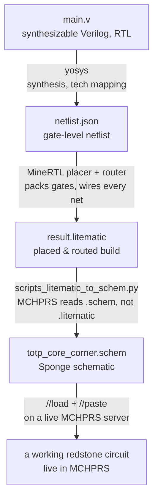

# The M in MFA stands for Minecraft

 

A working TOTP (Time-based One-Time Password) generator — the same algorithm behind Google
Authenticator, Authy, and every other 6-digit MFA app — built out of nothing but Minecraft redstone.
Give it a secret key and a time counter, and it computes HMAC-SHA1, truncates it, and outputs the same
6-digit code your phone would show. No mods, no command blocks, no datapacks — just repeaters, dust,
torches, and levers.

*The full circuit as a single paste — roughly 220×240×468 blocks, ~835,000 non-air blocks. Each flat
colored plane is a signal "lane": wool marks ownership/routing, the actual logic rides on the dust and
repeaters threaded through it.*

*Flying through the interior. What looks like abstract color-coded wiring is the literal data path of a
SHA-1 round engine — registers, the message schedule, and the add tree that computes `rol5(a) + f + e + K + w`
every clock cycle.*

## What this actually is

HMAC-SHA1 with a 30-second time step, 6-digit output — [RFC 4226](https://www.rfc-editor.org/rfc/rfc4226)
(HOTP) and [RFC 6238](https://www.rfc-editor.org/rfc/rfc6238) (TOTP). The secret key is baked into the
circuit at build time (same key authenticator apps are provisioned with); the only thing a player supplies
live is the current time counter. The circuit runs two SHA-1 compressions and a truncate/mod-10⁶ step, then
lights up 20 lamps carrying the binary code.

This project went through two completely different construction methods before landing on the one that
actually scales — both are worth explaining, because the pivot is the interesting part.

## Attempt 1: hand-placed gates

The first approach was the obvious one: design NOT/AND/OR/XOR gates out of redstone primitives, verify each
one against a live MCHPRS server, then wire them together by hand into bigger structures (a half adder, a
full adder, eventually a whole SHA-1 round). This got as far as a cleanly verified NOT/OR/AND gate library
and a mostly-working XOR, but a 1-bit full adder stalled out: composing even four or five gates together
turned into a 3D wire-routing puzzle, where fixing one collision between two signal paths reliably created
a new, narrower one somewhere else. At that rate, hand-routing the ~130,000–280,000 gates a full HMAC-SHA1
core needs was never going to finish. (The gate-level findings from this phase — torch orientation quirks,
repeater `facing` conventions, why shared dust junctions silently fail in MCHPRS — are kept in `docs/` as
real, still-useful empirical results about this engine, even though the construction method itself was
abandoned.)

## Attempt 2: synthesize it, don't place it by hand

The actual unlock was [MineRTL](https://github.com/saucefishman/MineRTL) — a Verilog-to-Minecraft-redstone
synthesizer. Instead of hand-routing gates, you write ordinary synthesizable Verilog, and MineRTL runs it
through [Yosys](https://github.com/YosysHQ/yosys) for logic synthesis, then does its own automatic gate
placement and 3D redstone routing, and emits a `.litematic` schematic ready to paste into a world.

### The pipeline, end to end

The Verilog itself (`MineRTL_designs/totp_core/main.v`) is a fairly direct translation of this project's
own from-scratch, RFC-vector-verified software models (`ref.py`, `datapath.py`, `netlist.py`):

- **Key schedule, offline.** `S_in = compress(IV, key ⊕ ipad)` and `S_out = compress(IV, key ⊕ opad)` are
  precomputed in Python for the fixed test key and baked in as Verilog constants — the circuit only ever
  runs the 2 compressions that actually depend on the live time counter, not the whole HMAC key-prep step.
- **One FSM, two passes.** `IDLE → LOAD1 → RUN1 (×80 rounds) → FF1 → LOAD2 → RUN2 (×80 rounds) → FF2 →
  TRUNC → DONE`. Each `RUN` phase is 80 cycles of the standard SHA-1 round function (`f`, the message
  schedule's 16-word sliding window, the 5-operand add `rol5(a) + f + e + K + w`), ported with the exact
  same indexing the earlier gate-level model (`netlist.py`) used and already had verified bit-exact.
- **Truncation**, done the simple way: a dynamic 32-bit part-select picks the right 4 bytes out of the
  20-byte digest based on its last nibble, masks the top bit, and reduces mod 1,000,000 with Verilog's `%`
  — no hand-rolled restoring divider needed, since MineRTL's synthesis + auto place-and-route absorbs that
  complexity for free.

### Verification, in two stages

1. **Simulation.** A testbench (`MineRTL_designs/totp_core_tb/tb_main.v`) drives the Verilog through
   [Icarus Verilog](https://github.com/steveicarus/iverilog) and checks it against all 10 RFC 4226 test
   vectors for the key `12345678901234567890`. All 10 pass, bit-exact.
2. **Synthesis + place + route.** The same Verilog, run through MineRTL's full pipeline:

   | metric | value |
   |---|---|
   | gates/cells placed | 6,019 |
   | nets routed | 6,170 |
   | failed nets | **0** |
   | verify errors | **0** |
   | workspace footprint | 220 × 240 × 468 blocks |
   | non-air blocks in the final paste | 835,116 |
   | critical path | 972 redstone ticks / clock cycle |
   | build time (synth → litematic) | ~75 seconds |

   Zero failed nets and zero verify errors on a build this size, on the first real attempt, is the thing
   that made this whole approach worth switching to.

## Getting it onto a real server

MineRTL writes Litematica's `.litematic` format; the [MCHPRS](https://github.com/MCHPR/MCHPRS) server this
project runs (for its speed — `/rtps unlimited`, no vanilla tick-rate limits) only reads Sponge `.schem`.
`scripts_litematic_to_schem.py` bridges the two: it reads the litematic back with
[`litemapy`](https://github.com/SmylerMC/litemapy), merges every region (a paste can be made of several —
this build's own clock generator is a separate region layered on top of the main logic), and re-emits it
through this project's existing Sponge schematic writer.

Pin positions — which world coordinate is `counter[12]`'s lever, which one is `code[7]`'s lamp — come from
patching MineRTL's own `scripts/build_with_pins.py` into the same build, which records every I/O pin's
position and orientation as the tool places it.

Driving the server is a headless [mineflayer](https://github.com/PrismarineJS/mineflayer) bot
(`bot/totp_core_probe.js`): it pastes the schematic, pulses reset, sets the 32-bit counter via levers,
pulses start, and polls for the output lamps to settle — all through real in-game WorldEdit commands and
block interactions, the same way a player would, just scripted.

## Status

Simulation-verified and synthesis-verified exactly as described above. Live, in-server confirmation of a
correct 6-digit code is the one box not yet checked: a run is in progress, and this README will be updated
honestly once it either completes or reveals something that needs fixing, rather than claiming success
ahead of the result. See `docs/handoff-live-verification-2026-11-19.md` for the detailed debugging trail —
pasting correctly, reading lamp state correctly, and why Redpiler (MCHPRS's JIT compiler) currently can't
compile this specific build (`"Exceeded the maximum number of default inputs 255"`, likely the clock or
reset net fanning out to ~1,186 flip-flops directly) all turned out to be real, separate problems worth
documenting for whoever picks this up next.
