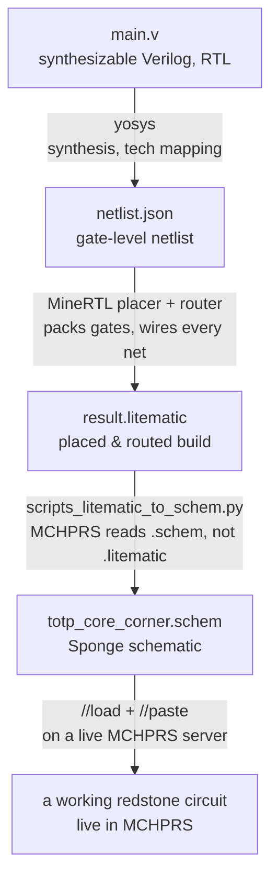

# The M in MFA stands for Minecraft

 

A working TOTP (Time-based One-Time Password) generator — the same algorithm behind Google
Authenticator, Authy, and every other 6-digit MFA app — built out of nothing but Minecraft redstone.
Give it a secret key and a time counter, and it computes HMAC-SHA1, truncates it, and outputs the same
6-digit code your phone would show. No mods, no command blocks, no datapacks — just repeaters, dust,
torches, and levers.

*The full circuit as a single paste — roughly 220×240×468 blocks, ~835,000 non-air blocks. Each flat
colored plane is a signal "lane": wool marks ownership/routing, the actual logic rides on the dust and
repeaters threaded through it.*

*Flying through the interior. What looks like abstract color-coded wiring is the literal data path of a
SHA-1 round engine — registers, the message schedule, and the add tree that computes `rol5(a) + f + e + K + w`
every clock cycle.*

## What this actually is

HMAC-SHA1 with a 30-second time step, 6-digit output — [RFC 4226](https://www.rfc-editor.org/rfc/rfc4226)
(HOTP) and [RFC 6238](https://www.rfc-editor.org/rfc/rfc6238) (TOTP). The secret key is baked into the
circuit at build time (same key authenticator apps are provisioned with); the only thing a player supplies
live is the current time counter. The circuit runs two SHA-1 compressions and a truncate/mod-10⁶ step, then
lights up 20 lamps carrying the binary code.

This project went through two completely different construction methods before landing on the one that
actually scales — both are worth explaining, because the pivot is the interesting part.

## Attempt 1: hand-placed gates

The first approach was the obvious one: design NOT/AND/OR/XOR gates out of redstone primitives, verify each
one against a live MCHPRS server, then wire them together by hand into bigger structures (a half adder, a
full adder, eventually a whole SHA-1 round). This got as far as a cleanly verified NOT/OR/AND gate library
and a mostly-working XOR, but a 1-bit full adder stalled out: composing even four or five gates together
turned into a 3D wire-routing puzzle, where fixing one collision between two signal paths reliably created
a new, narrower one somewhere else. At that rate, hand-routing the ~130,000–280,000 gates a full HMAC-SHA1
core needs was never going to finish. (The gate-level findings from this phase — torch orientation quirks,
repeater `facing` conventions, why shared dust junctions silently fail in MCHPRS — are kept in `docs/` as
real, still-useful empirical results about this engine, even though the construction method itself was
abandoned.)

## Attempt 2: synthesize it, don't place it by hand

The actual unlock was [MineRTL](https://github.com/saucefishman/MineRTL) — a Verilog-to-Minecraft-redstone
synthesizer. Instead of hand-routing gates, you write ordinary synthesizable Verilog, and MineRTL runs it
through [Yosys](https://github.com/YosysHQ/yosys) for logic synthesis, then does its own automatic gate
placement and 3D redstone routing, and emits a `.litematic` schematic ready to paste into a world.

### The pipeline, end to end

The Verilog itself (`MineRTL_designs/totp_core/main.v`) is a fairly direct translation of this project's
own from-scratch, RFC-vector-verified software models (`ref.py`, `datapath.py`, `netlist.py`):

- **Key schedule, offline.** `S_in = compress(IV, key ⊕ ipad)` and `S_out = compress(IV, key ⊕ opad)` are
  precomputed in Python for the fixed test key and baked in as Verilog constants — the circuit only ever
  runs the 2 compressions that actually depend on the live time counter, not the whole HMAC key-prep step.
- **One FSM, two passes.** `IDLE → LOAD1 → RUN1 (×80 rounds) → FF1 → LOAD2 → RUN2 (×80 rounds) → FF2 →
  TRUNC → DONE`. Each `RUN` phase is 80 cycles of the standard SHA-1 round function (`f`, the message
  schedule's 16-word sliding window, the 5-operand add `rol5(a) + f + e + K + w`), ported with the exact
  same indexing the earlier gate-level model (`netlist.py`) used and already had verified bit-exact.
- **Truncation**, done the simple way: a dynamic 32-bit part-select picks the right 4 bytes out of the
  20-byte digest based on its last nibble, masks the top bit, and reduces mod 1,000,000 with Verilog's `%`
  — no hand-rolled restoring divider needed, since MineRTL's synthesis + auto place-and-route absorbs that
  complexity for free.

### Verification, in two stages

1. **Simulation.** A testbench (`MineRTL_designs/totp_core_tb/tb_main.v`) drives the Verilog through
   [Icarus Verilog](https://github.com/steveicarus/iverilog) and checks it against all 10 RFC 4226 test
   vectors for the key `12345678901234567890`. All 10 pass, bit-exact.
2. **Synthesis + place + route.** The same Verilog, run through MineRTL's full pipeline:

   | metric | value |
   |---|---|
   | gates/cells placed | 6,019 |
   | nets routed | 6,170 |
   | failed nets | **0** |
   | verify errors | **0** |
   | workspace footprint | 220 × 240 × 468 blocks |
   | non-air blocks in the final paste | 835,116 |
   | critical path | 972 redstone ticks / clock cycle |
   | build time (synth → litematic) | ~75 seconds |

   Zero failed nets and zero verify errors on a build this size, on the first real attempt, is the thing
   that made this whole approach worth switching to.

## Getting it onto a real server

MineRTL writes Litematica's `.litematic` format; the [MCHPRS](https://github.com/MCHPR/MCHPRS) server this
project runs (for its speed — `/rtps unlimited`, no vanilla tick-rate limits) only reads Sponge `.schem`.
`scripts_litematic_to_schem.py` bridges the two: it reads the litematic back with
[`litemapy`](https://github.com/SmylerMC/litemapy), merges every region (a paste can be made of several —
this build's own clock generator is a separate region layered on top of the main logic), and re-emits it
through this project's existing Sponge schematic writer.

Pin positions — which world coordinate is `counter[12]`'s lever, which one is `code[7]`'s lamp — come from
patching MineRTL's own `scripts/build_with_pins.py` into the same build, which records every I/O pin's
position and orientation as the tool places it.

Driving the server is a headless [mineflayer](https://github.com/PrismarineJS/mineflayer) bot
(`bot/totp_core_probe.js`): it pastes the schematic, pulses reset, sets the 32-bit counter via levers,
pulses start, and polls for the output lamps to settle — all through real in-game WorldEdit commands and
block interactions, the same way a player would, just scripted.

## Why it was slow, and what got fixed

The first live run sat computing for close to an hour without finishing. The server stayed pegged at
100% CPU the whole time — genuinely still working, not stuck — but that's exactly the problem: MCHPRS's
plain tick loop is interpreted, one component update at a time, and this circuit is big enough that an
hour wasn't even close to enough. Three real causes, investigated and fixed or explained:

**1. Redpiler (MCHPRS's JIT compiler for redstone) panics on this build — turned out to be a known, already-patched bug, not a fundamental limit.**
MCHPRS ships a compiler, Redpiler, that turns a circuit into compiled native code instead of interpreting
it tick-by-tick — normally a 10–1000x speedup for exactly this kind of large synchronous circuit. Trying
to enable it here crashed the server: `panicked at crates/redpiler/src/backend/direct/compile.rs:48:21:
Exceeded the maximum number of default inputs 255`. Reading our own synthesized netlist showed the circuit's
clock net really does fan out to all ~1,186 flip-flops directly (no clock-tree buffering — MineRTL doesn't
insert one), which looked like the obvious culprit. It wasn't, or at least wasn't the whole story:
[benburk/MCHPRS PR #2](https://github.com/benburk/MCHPRS/pull/2 "wire-on-wire fix") — not yet merged
upstream — fixes a real bug in Redpiler's input-search pass: when redstone wire is stacked directly on top
of other wire (same X/Z, different Y — something that can only happen from a paste, never natural block
placement), the search re-walks and re-counts the same links repeatedly until the input cap trips. Their
own benchmark: a stacked circuit went from refusing to compile within 120 seconds to compiling in **0.33
seconds**. We applied the fix to our own MCHPRS fork (`mchprs/crates/redpiler/src/passes/frontend/input_search.rs`)
and rebuilt.

**2. A genuinely redundant register, found by reading our own netlist.** The message schedule (`sched`, a
16-word sliding window) and a separate `block_mem` array were both being kept as full 32×16-bit registers.
Tracing the math: for the first 16 rounds, `sched` is *provably* just a rotation of the original block
words, so `sched[0]` already holds exactly what `block_mem[round]` was being read for. `block_mem` was dead
weight — removed entirely, no behavior change, verified bit-exact against all 10 RFC vectors again
afterward.

**3. The round-function's critical add, pipelined one stage.** Each SHA-1 round computes
`rol5(a) + f(b,c,d) + e + K[t] + w` — as written, that's 4 sequential 32-bit adds every single cycle. The
classic hardware trick: compute `e + K[t+1] + w[t+1]` for the *next* round one cycle early, off the critical
path, and register it. Each round's real-time critical add then drops to `rol5(a) + f + (precomputed e+K+w)`
— 2 adds instead of 4.

| metric | before | after | change |
|---|---|---|---|
| gates/cells | 6,019 | 5,625 | −6.5% |
| flip-flops | 1,186 | 1,056 | −11% |
| nets | 6,170 | 5,776 | −6.4% |
| non-air blocks | 835,116 | 770,245 | −7.8% |
| critical path | 972 ticks | 958 ticks | −1.4% |

Honest note on that last row: the critical-path drop is much smaller than a 4-adds-to-2-adds change would
suggest in isolation. MineRTL's own timing report shows a large chunk of that number comes from
clock-skew-compensation delay added across the build's physical size (hold-time fixing added ~3,465 ticks
of repeater delay across 1,056 flip-flops), not from the logical add-chain depth — so on a build this
physically large, propagation distance dominates over logic depth. The optimization is still correct and
still shrinks the circuit, just not primarily *for the reason it was originally expected to*.

**Deliberately not attempted:** a bit-serial datapath (process 1 bit at a time instead of 32 in parallel)
would cut flip-flop and gate count much further, at the cost of roughly 32x more clock cycles — a real
architecture rewrite, not a tweak, and risky to do without time to fully re-verify. Flagged as the next
lever to pull if the above isn't enough, not implemented here.

## Status

Simulation-verified and synthesis-verified as described above, on both the original and the optimized
build. Live, in-server confirmation of a correct 6-digit code is the one box not yet checked — a run with
the fixed Redpiler and the optimized circuit is in progress, and this section will be updated honestly once
it completes or reveals something that needs fixing, rather than claiming success ahead of the result. See
`docs/handoff-live-verification-2026-11-19.md` for the full debugging trail.
